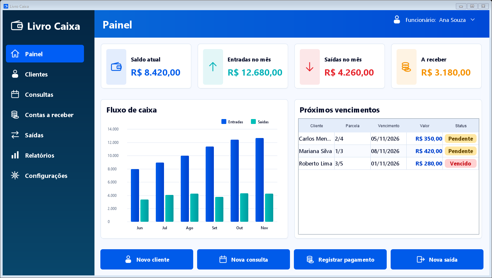
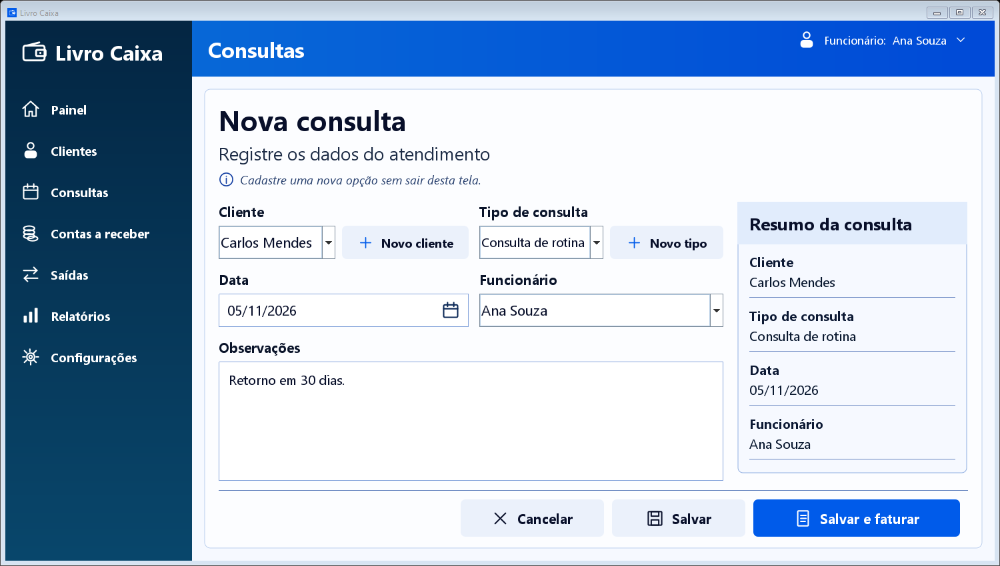
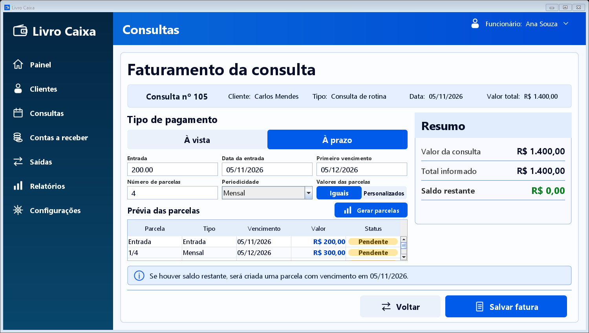
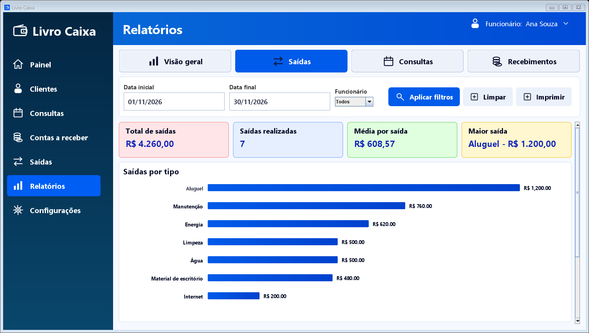

# Livro Caixa - Front-end em Java Swing

Protótipo navegável da interface de um sistema de controle financeiro, desenvolvido em **Java Swing**. O projeto reproduz as telas e os fluxos visuais definidos para o Livro Caixa, com identidade azul, menu lateral, formulários, tabelas, gráficos, relatórios e estados de confirmação.

> **Importante:** este repositório contém somente o **front-end visual**. Não há banco de dados, API, autenticação real ou persistência definitiva. Os dados são demonstrativos e servem para apresentar a navegação e o comportamento esperado das telas.

## Objetivo do projeto

O objetivo atual é permitir que a equipe valide a aparência, a organização e o fluxo do software antes da implementação das regras de negócio e do banco de dados. Os botões navegam entre as telas e simulam ações para tornar o protótipo apresentável, mas não representam uma versão pronta para produção.

Durante a execução, alguns dados podem ser alterados temporariamente em memória. Ao fechar e abrir novamente o aplicativo, os exemplos iniciais são restaurados.

## Prévia das telas

| Painel | Nova consulta |
|---|---|
|  |  |

| Faturamento a prazo | Relatório de saídas |
|---|---|
|  |  |

## Telas e fluxos disponíveis

- Acesso ao sistema e painel financeiro.
- Listagem, busca e formulário de clientes.
- Listagem, filtros e formulário de consultas.
- Faturamento da consulta à vista ou a prazo.
- Geração e visualização de parcelas.
- Contas a receber e registro de pagamento.
- Pagamento parcial, desconto em reais ou porcentagem.
- Cancelamento de parcela e opção para desfazer uma baixa.
- Listagem e cadastro de saídas.
- Relatórios de visão geral, saídas, consultas e recebimentos.
- Rolagem vertical nos relatórios para acessar gráficos e tabelas.
- Configuração de funcionários, perfis e cadastros auxiliares.

### Fluxo principal de demonstração

1. Entrar no sistema.
2. Acessar o painel.
3. Cadastrar ou consultar um cliente.
4. Criar uma nova consulta.
5. Selecionar **Salvar e faturar**.
6. Escolher pagamento **À vista** ou **À prazo**.
7. Gerar as parcelas e salvar a fatura.
8. Consultar os valores em **Contas a receber** e **Relatórios**.

## Requisitos

- Windows 10 ou Windows 11 para utilizar os atalhos fornecidos.
- **JDK 17** ou mais recente instalado.
- Os comandos `java`, `javac` e `jar` disponíveis no `PATH` do sistema.

Para verificar a instalação:

```powershell
java -version
javac -version
```

## Como executar

### Opção mais simples

Dê dois cliques em:

```text
Iniciar Livro Caixa.bat
```

O arquivo compila o projeto automaticamente quando o JAR ainda não existir e, em seguida, inicia o aplicativo.

### Executar pelo PowerShell

```powershell
powershell -ExecutionPolicy Bypass -File .\run.ps1
```

### Compilar manualmente

```powershell
powershell -ExecutionPolicy Bypass -File .\build.ps1
```

O arquivo executável será gerado em:

```text
build\LivroCaixa.jar
```

Depois da compilação, também é possível iniciar com:

```powershell
java -jar .\build\LivroCaixa.jar
```

## Dados de acesso demonstrativos

- **Funcionário:** `Ana Souza`
- **Senha:** qualquer valor não vazio, por exemplo `123456`

Esses dados não são validados em servidor. O formulário existe apenas para representar o fluxo visual de autenticação.

## Estrutura do código

```text
src/livrocaixa/
|- LivroCaixaApp.java           Entrada do programa, janela principal, navegação e dados de exemplo
|- UiKit.java                   Componentes, cores, ícones e estilos reutilizáveis
|- OperationalListScreens.java Telas de clientes, consultas e saídas
|- ConsultationScreens.java    Formulário visual de nova consulta
|- BillingScreen.java          Faturamento à vista e a prazo
|- FinanceListScreens.java     Listagens financeiras e contas a receber
|- PaymentScreens.java         Registro visual de pagamentos e descontos
|- ConfirmedPaymentScreen.java Confirmação e opção para desfazer baixa
|- ManagementScreens.java      Relatórios, configurações e cadastros auxiliares
`- SmokeTest.java              Verificação automática da abertura e navegação das telas
```

Arquivos auxiliares:

- `build.ps1`: compila os arquivos Java e gera o JAR.
- `run.ps1`: compila quando necessário e inicia o aplicativo.
- `Iniciar Livro Caixa.bat`: atalho de execução para Windows.

## Verificação do front-end

Depois de compilar, o teste de navegação pode ser executado com:

```powershell
java -cp .\build\classes livrocaixa.SmokeTest
```

O resultado esperado no terminal é:

```text
SMOKE_TEST_OK
```

## O que ainda será desenvolvido

Em uma próxima etapa, o front-end poderá ser conectado a uma arquitetura MVC completa. As principais integrações pendentes são:

- Modelos e validações das entidades do sistema.
- Controllers para separar a interface das regras de negócio.
- Serviços de clientes, consultas, faturamento, parcelas e pagamentos.
- Repositórios para leitura e gravação dos dados.
- Banco de dados e scripts de criação das tabelas.
- Autenticação e controle real de usuários e perfis.
- Tratamento de erros, auditoria e testes das regras de negócio.

As classes de tela foram separadas por área justamente para facilitar essa integração sem precisar reconstruir toda a interface.

## Situação atual

- [x] Identidade visual azul.
- [x] Telas navegáveis em Java Swing.
- [x] Fluxos de cadastro, faturamento, pagamento e relatórios.
- [x] Dados demonstrativos para apresentação.
- [x] Teste geral de abertura das telas.
- [ ] Banco de dados.
- [ ] Persistência definitiva.
- [ ] Regras de negócio completas.
- [ ] Back-end integrado.

---

Projeto acadêmico - versão atual destinada à apresentação e validação do **front-end**.
